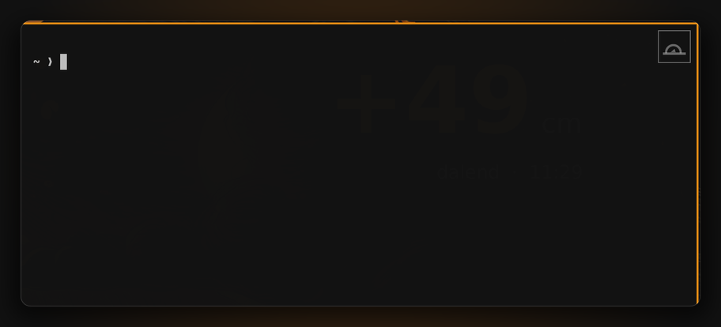
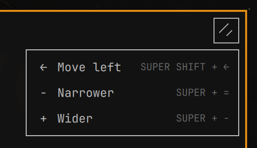

# mouse-in-the-corner

A small clickable grip in the **top-right corner of the focused window** for
[Omarchy](https://omarchy.org/) 4 (Hyprland + Quickshell). Click it and a tiny
pad drops down that resizes or moves the window — no keybinding to remember.

The grip, idle — top-right corner of the focused window:



The pad, open. This window is the right-hand tile, so it has no `Move right`,
and each row carries the hotkey that does the same thing:



Only the moves that can actually happen are shown: a window already on the
right edge of the layout gets no `Move right`, a full-width tile gets neither
left nor right, and so on. The pad shrinks to fit whatever is left.

Each row also shows the hotkey that does the same thing (`SUPER SHIFT + ←`,
`SUPER + −`, …), so you learn the keyboard route as you click. The hints are
read from Omarchy's own keybinding cache — the one `SUPER+K` builds — which
means they follow your bindings rather than a hardcoded list. They are
refreshed every time the pad opens, and a row simply shows no hint when no
binding matches it.

## Behaviour

| Action | Tiled window | Floating window |
| --- | --- | --- |
| ↑ ↓ ← → | swaps the tile with its neighbour (like `SUPER+SHIFT+arrow`); hidden when no tile sits on that side | nudges it 80 px (always available) |
| − / + | moves the shared split edge 80 px, so this window gets narrower/wider (grows along the stacked axis when the tile is full width) | resizes it 80 px |

- The grip only appears for the focused window, and is hidden for fullscreen
  windows and when the workspace is not visible.
- Click the grip again to close the pad, or leave it alone: it closes itself
  after 6 seconds without a click.
- The pad follows the window, so you can hit `+` a few times in a row.
- Everything is dispatched through Hyprland's Lua dispatchers
  (`hl.dsp.window.*`) addressed by window address, so it never depends on what
  happens to hold focus while you click.

## Requirements

- Omarchy 4.x (Quickshell-based shell, Hyprland with Lua config).
- Nothing else — no extra packages, no compositor plugin.

## Install

The plugin is discovered from `~/.config/omarchy/plugins/<anything>/`, and its
manifest id (`eep.window-controls`) is what `shell.json` refers to.

```bash
git clone https://github.com/evtriest/mouse-in-the-corner.git \
  ~/.config/omarchy/plugins/eep.window-controls
```

Then add it to `plugins` in `~/.config/omarchy/shell.json`:

```json
{
  "plugins": [
    { "id": "eep.window-controls" }
  ]
}
```

`shell.json` reloads on save. If the plugin does not appear, force a rescan or
restart the shell:

```bash
omarchy-shell shell rescanPlugins
omarchy restart shell
```

Check that it is talking to the compositor:

```bash
omarchy-shell window-controls status
```

## Tuning

The `readonly` values at the top of `WindowControls.qml`:

| Property | Default | Meaning |
| --- | --- | --- |
| `buttonSize` | `26` | size of the grip in px |
| `buttonInset` | `6` | how far inside the window's top-right corner it sits |
| `step` | `80` | px per resize/nudge click |
| `pollInterval` | `300` | ms between `hyprctl` geometry refreshes |
| `autoCloseMs` | `6000` | idle time before the pad closes itself |
| `neighborTolerance` | `60` | how big a gap/border still counts as "a tile next to me" |

The grip is semi-transparent until you hover it, and takes its colours from the
current Omarchy theme (`menu.background` / `menu.text` / `menu.border`).

## Optional: same pad from the keyboard

The plugin registers an IPC target, so you can bind it — for example in
`~/.config/hypr/bindings.lua`:

```lua
o.bind("SUPER + SHIFT + W", "Window pad", "omarchy-shell window-controls toggle")
```

Also available: `omarchy-shell window-controls act wider` (and `narrower`,
`left`, `right`, `up`, `down`).

## How it works

Hyprland has no per-window decoration to hang a widget off, so the plugin polls
`hyprctl -j activewindow`, `-j monitors` and `-j clients` every 300 ms (about
0.1 % of a core), works out which tiles touch which side of the focused window,
computes its top-right corner on its output, and places a
transparent full-screen layer-shell surface per monitor whose input region is
masked down to the grip. The rest of that surface never eats clicks meant for
the application. The pad is a second masked surface, created only while it is
open.

## Limitations

- The grip covers a 26×26 px spot of the focused window's own top-right corner;
  increase `buttonInset` or change `buttonX`/`buttonY` if that overlaps something
  you click in a particular app.
- Positions assume the geometry `hyprctl clients` reports (layout/logical
  pixels). Windows mid-drag or mid-animation may lag a frame behind.
- Only tested on a single-output setup at `scale = 2`.

## License

MIT
