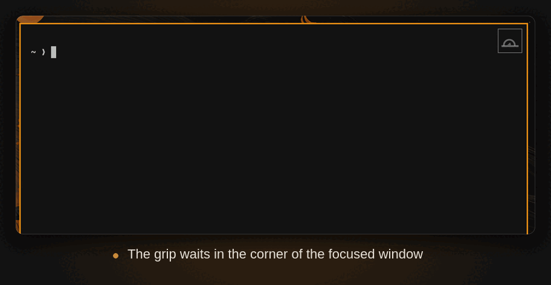

# mouse-in-the-corner

A small clickable **mousetrap** in the corner of the focused window plus a **cat button** in the bar for [Omarchy](https://omarchy.org/) 4 (Hyprland + Quickshell). Click the grip and a tiny pad drops down that resizes or moves the window — no keybinding to remember.

Quick demo — the grip, the pad it opens, and a `Wider` / `Narrower` click acting on the window:



Only the moves that can actually happen are shown: a window already on the
right edge of the layout gets no `Move right`, a full-width tile gets neither
left nor right, and so on. The pad shrinks to fit whatever is left.

Each row also shows the hotkey that does the same thing (`SUPER SHIFT + ←`,
`SUPER + −`, …), so you learn the keyboard route as you click. The hints are
read from Omarchy's own keybinding cache — the one `SUPER+K` builds — which
means they follow your bindings rather than a hardcoded list. They are
refreshed every time the pad opens, and a row simply shows no hint when no
binding matches it.

## Bar menu

A cat button sits in the Omarchy bar. Left click opens a menu with:

- **Grip corner** — pick any corner of the focused window (`tl`, `tr`, `bl`,
  `br`). Switching corner plays a short corner-chase animation.
- **Keybinding hints** — toggle the hotkey labels on the pad on/off.
- **Grip on/off** — a toggle switch that hides the grip entirely while keeping
  the plugin loaded. Right-clicking the bar button also toggles it.
- While the grip is off the cat button shows a sleeping icon (󰄛󰒲).

## Corner chase animation

Every time the corner changes or the grip is switched back on, a one-shot
overlay plays: a mouse darts across the screen, visits another window along the
way, then changes course and races into the picked corner while a cat chases it
and leaps to catch it. The animation is click-through and lasts about five
seconds. It is purely cosmetic — it does not steal focus or block input.

## Behaviour

| Action | Tiled window | Floating window |
| --- | --- | --- |
| ↑ ↓ ← → | swaps the tile with its neighbour (like `SUPER+SHIFT+arrow`); hidden when no tile sits on that side | nudges it 80 px (always available) |
| − / + | moves the shared split edge 80 px, so this window gets narrower/wider (grows along the stacked axis when the tile is full width) | resizes it 80 px |

- The grip only appears for the focused window, and is hidden for fullscreen
  windows and when the workspace is not visible.
- Click the grip again to close the pad, or leave it alone: it closes itself
  after 6 seconds without a click.
- The pad follows the window, so you can hit `+` a few times in a row.
- Everything is dispatched through Hyprland's Lua dispatchers
  (`hl.dsp.window.*`) addressed by window address, so it never depends on what
  happens to hold focus while you click.

## Requirements

- Omarchy 4.x (Quickshell-based shell, Hyprland with Lua config).
- Nothing else — no extra packages, no compositor plugin.

## Install

Use Omarchy's plugin manager to install the repository:

```bash
omarchy plugin add https://github.com/evtriest/mouse-in-the-corner.git
```

Plugins are added disabled so you can review their code before enabling them.
After reviewing this plugin, enable it with its manifest id:

```bash
omarchy plugin enable eep.window-controls
```

Check that it is talking to the compositor:

```bash
omarchy-shell window-controls status
```

## Uninstall

Remove the plugin with Omarchy's plugin manager. This removes its checkout and
disables it in the shell configuration:

```bash
omarchy plugin remove eep.window-controls
```

If you changed the grip size and also want to reset the saved setting, remove
its separate settings file:

```bash
rm -f ~/.config/omarchy/window-controls.json
```

The plugin adds no autostart entry or other configuration.

## Size

The grip starts at 34 px. Resize it without touching any file:

```bash
omarchy-shell window-controls size 44    # anywhere from 16 to 96 px
omarchy-shell window-controls status     # reports the current "buttonSize"
```

The new size applies immediately and is remembered: it is written to
`~/.config/omarchy/window-controls.json` and re-read when the shell starts, so
a restart, a logout or a `git pull` keeps the size you chose. The file lives
outside the plugin directory, so it never shows up as a local change in git.

Anything outside 16–96 px is refused rather than drawn: a size below the
minimum is unusable, so it stays at 16 px and you get a desktop notification
saying so (same for anything above the maximum, which stays at 96 px). Want the
stock grip back? Disable and remove the plugin and clone it again from GitHub,
or delete `~/.config/omarchy/window-controls.json`.

## Tuning

The values at the top of `WindowControls.qml`:

| Property | Default | Meaning |
| --- | --- | --- |
| `buttonSize` | `34` | size of the grip in px (change it with the `size` command above) |
| `minButtonSize` / `maxButtonSize` | `16` / `96` | the range `size` accepts |
| `buttonInset` | `6` | how far inside the window's corner it sits |
| `step` | `80` | px per resize/nudge click |
| `pollInterval` | `300` | ms between `hyprctl` geometry refreshes |
| `autoCloseMs` | `6000` | idle time before the pad closes itself |
| `neighborTolerance` | `60` | how big a gap/border still counts as "a tile next to me" |

The grip is semi-transparent until you hover it, and takes its colours from the
current Omarchy theme (`menu.background` / `menu.text` / `menu.border`).

## Optional: same pad from the keyboard

The plugin registers an IPC target, so you can bind it — for example in
`~/.config/hypr/bindings.lua`:

```lua
o.bind("SUPER + SHIFT + W", "Window pad", "omarchy-shell window-controls toggle")
```

Also available: `omarchy-shell window-controls act wider` (and `narrower`,
`left`, `right`, `up`, `down`), and `omarchy-shell window-controls size 44` for
the grip size.

## How it works

Hyprland has no per-window decoration to hang a widget off, so the plugin polls
`hyprctl -j activewindow`, `-j monitors` and `-j clients` every 300 ms (about
0.1 % of a core), works out which tiles touch which side of the focused window,
computes its top-left corner on its output, and places a
transparent full-screen layer-shell surface per monitor whose input region is
masked down to the grip. The rest of that surface never eats clicks meant for
the application. The pad is a second masked surface, created only while it is
open.

## Limitations

- The grip covers a 34×34 px spot of the focused window's own corner; make it
  smaller with the `size` command (16 px is the minimum), or increase
  `buttonInset` if that overlaps something you click in a particular app.
- Positions assume the geometry `hyprctl clients` reports (layout/logical
  pixels). Windows mid-drag or mid-animation may lag a frame behind.
- Only tested on a single-output setup at `scale = 2`.

## Credits

Created by **Eep van Triest** — [github.com/evtriest](https://github.com/evtriest).

Built with [Freebuff](https://freebuff.com), running DeepSeek V4.1 Flash 10/17.
The mousetrap mark is drawn in QML, so it scales with the grip instead of
relying on an icon font.

## License

MIT
